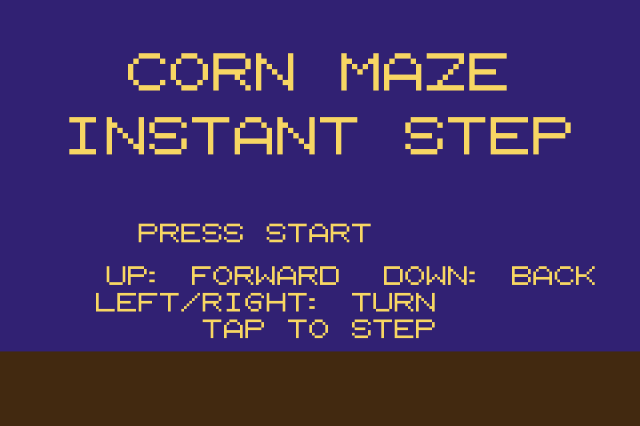
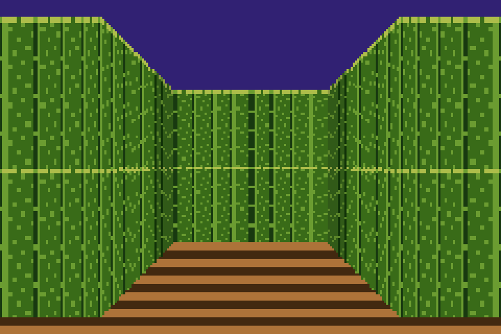
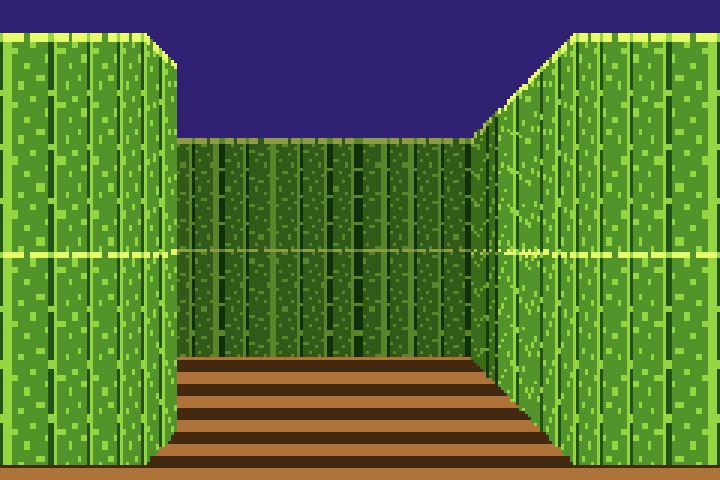
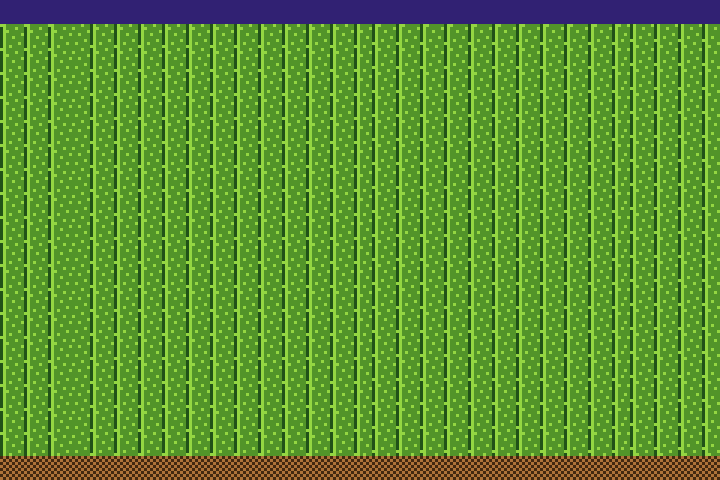

# Slice — GBA prototype

A first-person maze prototype for the Game Boy Advance, in Wizardry style: tile-to-tile movement with instant redraw, no smooth transition. Not a full game: a small maze to walk, turn, and escape from.

## Play

Browser: https://holy-ember-c5aq.here.now/

Or load `releases/raycaster-gba-slice.gba` in a GBA emulator.

## Controls

- Up: step forward one tile
- Down: step back one tile
- Left / Right: turn 90 degrees
- Start: start / restart
- Tap to step. Holding a direction repeats after a short pause.

Reach the clearing at the far end of the maze for the exit screen.

## Screenshots









## How it works

- Mode 0 tiled BG, 30x20 tiles of 8px, so a view redraw is only 600 map entries, not 38,400 pixels
- Wall heights come from a DDA raycaster (30 rays, one per tile column, fixed-point, table trig, zero per-frame divisions), so side openings show as wall-height steps, not blank dirt
- Textured corn walls with distance and side shading, capped at 144px so a close wall never fills the whole screen
- Instant movement: one map update per tap, then idle with no rendering until the next tap
- Short PSG step / bump / exit sounds only

## Build

Requires `arm-none-eabi-gcc` and Python 3.

```sh
bash build.sh
```

This produces `rayslice.gba` and copies it to `releases/raycaster-gba-slice.gba`. The header is patched by `fix_header.py` (title `RAYSLICE`, game code `RAYS`).

## Files

- `src/main.c` — game, slice renderer, sound, title / exit screens
- `src/trig.h` — sine / cosine tables
- `src/font.h` — 8x8 font glyphs
- `src/tables.h` — precomputed DDA / wall-height tables
- `src/crt0.s`, `gba.ld` — GBA startup and linker script
- `qa/harness.c`, `qa/render.py` — host QA harness (runs the game natively, dumps tiles / map / palette) and its tile renderer
