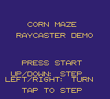
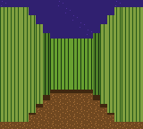
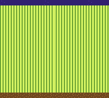
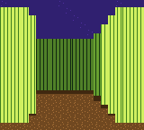
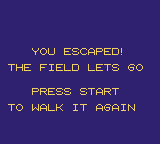

# Slice — GBC instant prototype

First-person maze prototype for the Game Boy Color, in Wizardry style: tile-to-tile movement with instant redraw, no smooth transition. Not a full game: a small maze to walk, turn, and escape from.

Load `raycaster-gbc-instant.gbc` in a GBC emulator.

## Controls

- Up: step forward one tile
- Down: step back one tile
- Left / Right: turn 90 degrees
- Start: start / restart
- Tap to step. Holding a direction repeats after a short pause.

## Screenshots

## How it works

- GBC tile hardware, one DDA ray per screen tile column (20 columns), wall height in pixels with precomputed top / bottom edge tiles
- Instant movement: the DDA runs once per tap, then the game renders exactly one full frame with the LCD off and goes idle with no rendering until the next tap
- Each tap briefly blanks the screen while the frame is written, then the new view appears instantly. That is the intended redraw, not a bug.
- Short step / bump sounds only

## Build

Requires GBDK-2020. See `build.sh` (adjust the GBDK path for your setup). This produces a plain 32KB ROM ONLY, CGB-compatible ROM.
